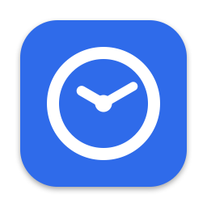

<p align="center"></p>

# Timelane

A native macOS app (SwiftUI) for developers to register working hours per project. It records which of your chosen apps are in the foreground and shows them on a day timeline, where you drag to assign time to projects. Everything is stored locally in SQLite.

## Features

- **Day timeline** with two lanes, "Tracked apps" (recorded automatically) and "Logged hours" (registered by you), each with a sticky header and separated by a divider. Drag over either lane to select a period, or click an app session to assign the whole session. Entries can be edited, moved and resized; right-click an entry for Edit or Delete. ⌘Z / ⇧⌘Z undo and redo changes to logged hours (create, edit, move, resize, delete), in the main window and the menu bar panel. Zoom from the hour overview down to 10-minute detail (pinch or zoom controls); hover cards show details. The automatic entry of a linked app grows live, in step with its app session.
- **Record / Stop timer** (Cmd-R in the main window, also in the menu bar panel): Record starts one shared timer that survives closing the window and relaunching the app; Stop opens the new-entry form with the period rounded to whole minutes. A recording past midnight is cut at the end of its start day. A red block in "Logged hours" shows the running recording.
- **Projects** with a colour, monthly totals and month navigation (Cmd-Left / Cmd-Right, Cmd-T for the current month).
- **Month export**: *Export…* (⇧⌘E) on the Projects screen writes all hours of the shown month to a JSON or Excel (.xlsx) file; you choose the format and the location.
- **Overview** (Cmd-4): a GitHub-style heatmap of the hours you registered per day in a calendar year (brighter square = more hours; hover for a card with the date and hours per project, click to open that day on the Timeline), with year navigation (Cmd-Left / Cmd-Right, Cmd-T), a project filter, statistic tiles (total, active days, average, busiest day), a stacked hours-per-month chart and a per-project breakdown.
- **Tracked apps**: only the apps you add are recorded. Tracking pauses on idle (after 5 minutes without input), sleep and screen lock. Optionally link an app to a project in the Project column: while you use it, a time entry for that project appears after 1 minute and grows every 5 seconds in "Logged hours" (small gaps of up to 1 minute merge into one entry, in step with the merged app block, and the entry keeps growing right away when you return to the app; also when Timelane is restarted in between or the visits were shorter than a minute; changing the link only affects new hours, idle time at the end of a run is removed, you can edit or delete it like any other entry and it is never overwritten afterwards).
- **Menu bar panel** with live tracking status (red dot while recording, grey "not tracking" icon for apps not on the list, grey pause icon when paused), the same timeline and a popup form to register time without opening the main window. The menu bar icon gets a small red dot while a recording runs. Tracking and the menu bar item keep running when the window is closed.
- **Local storage** in a SQLite database.

Keyboard: Cmd-1/2/3/4 switch between Timeline, Projects, Tracked Apps and Overview; in the project list of the entry form, Up/Down move the highlight and Enter chooses (or creates) the project.

## Requirements

- macOS 26.0 or later (the project's deployment target)
- Xcode 27.1 (used to develop it), Swift 6
- The app runs in the App Sandbox and needs no special permissions.

## Getting started

```sh
git clone https://github.com/NickKoepr/Timelane.git
cd Timelane
open Timelane.xcodeproj
```

Swift Package Manager resolves [GRDB](https://github.com/groue/GRDB.swift) (7.x) automatically. Select the `Timelane` scheme and run (bundle ID `nl.nickkoepr.timelane`). From the command line:

```sh
xcodebuild -project Timelane.xcodeproj -scheme Timelane -destination 'platform=macOS' -derivedDataPath build/DerivedData build
xcodebuild -project Timelane.xcodeproj -scheme Timelane -destination 'platform=macOS' -derivedDataPath build/DerivedData test
```

You will need to select your own development team under Signing & Capabilities.

## Architecture

Strict MVVM with one-directional dependencies:

- **Models**: plain value types (`Project`, `TimeEntry`, `AppSession`, `TrackedApp`).
- **Repositories**: protocols with GRDB implementations (`Repositories/GRDB`); they throw, view models catch.
- **ViewModels**: `@Observable @MainActor` classes with injected dependencies; no GRDB and no SwiftUI view types.
- **Views**: SwiftUI only, talking to view models. Each view has a `#Preview` using `AppEnvironment.preview()`.
- **Composition root**: `AppEnvironment` wires the database, repositories and tracker.
- **Tracking**: `AppActivityTracker` consumes an event stream (foreground app changes, idle, sleep, lock, heartbeat) and writes app sessions.
- **Database**: GRDB `DatabaseQueue` with migrations in `Migrations.swift`. Never edit an existing migration; add a new one.
- **Layout logic**: pure, unit-tested geometry and merging code in `Features/Timeline/Layout`.

## Project structure

```
Timelane/
  App/                  App entry point, AppDelegate, AppEnvironment (composition root)
  Models/               Value types: Project, TimeEntry, AppSession, TrackedApp
  Database/             AppDatabase (live/in-memory), Migrations.swift, Records/ (GRDB conformances)
  Repositories/         Repository protocols; GRDB/ holds the implementations
  Services/             Day totals, overlap resolving, running apps, app icons
    Activity/           Pure yearly statistics: day bucketing, heatmap layout, levels, statistics
    Backup/             Opt-in iCloud backup: CloudBackupService, CloudKit store, schedule and safety rules
    Tracking/           AppActivityTracker, AutoTimeLogger (linked app → growing entry), idle detection, system event observer, heartbeat
  Utilities/            DateRange, calendar helpers, duration formatting, colours
  Features/
    Root/               RootView and sidebar navigation
    Timeline/           Day timeline and time entry form
      Layout/           Pure geometry, zoom, drag and hover-card placement logic
      ViewModels/       TimelineViewModel, TimeEntryFormViewModel, ProjectSearch, ...
      Views/            Lanes, blocks, hover cards, form sheet
    Projects/           ViewModels/ and Views/ for projects and monthly totals
    Overview/           Yearly heatmap, statistics and charts
    TrackedApps/        ViewModels/ and Views/ for the tracked-apps list
    Settings/           Settings window (Timelane ▸ Settings…, ⌘,) with the iCloud backup tab
  MenuBar/              Menu bar panel: view model, content, form popup
  Debug/Screenshots/    DEBUG-only screenshot mode for the App Store images (sample data, self-capture)
  Assets.xcassets/      Accent colour and AppIcon
TimelaneTests/          Swift Testing unit tests
Tools/                  generate-app-icon.swift (app icon + menu bar icon), make-app-store-screenshots.sh + compose-app-store-screenshots.swift
docs/                   Images used by this README
plans/                  PLAN.md (base specification) and PLAN-v1.*.md (each iteration)
```

## Data & privacy

The database is a single SQLite file inside the app's sandbox container:

`~/Library/Containers/nl.nickkoepr.timelane/Data/Library/Application Support/Timelane/db.sqlite`

It stores projects, your time entries (start, end, optional title and note), the list of tracked apps, and app sessions: app name, bundle identifier, start and end. No window titles, keystrokes or screenshots are recorded. Nothing leaves your machine unless you turn on iCloud backup (see below); then the database goes only to your own private iCloud. Exported files are written only where you choose in the save panel.

## iCloud backup

Optional and off by default. Turn it on in *Timelane ▸ Settings…* (⌘,) on the *Backup* tab.

- **What is stored:** a consistent copy of the whole database (projects, logged hours, tracked apps, app sessions) as one file in your *private* CloudKit database (`iCloud.nl.nickkoepr.timelane`), plus a few counters (device name, app version, number of projects and entries). Nothing is shared with anyone.
- **When:** right after you turn it on, and then automatically, at most every 15 minutes while data changes. *Back Up Now* forces a backup.
- **Safety:** an automatic backup never replaces an iCloud backup that holds data with an empty database (e.g. after a reinstall). If a backup already exists when you turn the setting on, you choose between restoring it and replacing it.
- **Restore:** *Restore from iCloud…* downloads and checks the backup, then restarts Timelane, which swaps it in before opening the database. The previous database stays on this Mac as `db-before-restore.sqlite` next to `db.sqlite`.
- **Turning it off** stops uploads; the copy in iCloud is kept.

This is a snapshot backup, not a live sync between Macs. It needs the iCloud capability (CloudKit) for the app; CI builds strip it (`CODE_SIGN_ENTITLEMENTS=`).

## Development

- [`AGENTS.md`](AGENTS.md) explains the architecture, conventions, workflow and known pitfalls for anyone (or any AI agent) continuing work on the project; `CLAUDE.md` points to it.

- Tests use Swift Testing (140+ tests) and run with the `xcodebuild ... test` command above. Repository and view model tests use an in-memory database.
- In DEBUG builds the launch argument `-resetDatabase YES` deletes the database at startup. Use it with care: it wipes your data.
- The [`plans/`](plans) folder documents the design and each iteration; [`plans/PLAN.md`](plans/PLAN.md) is the base specification.
- Conventions ([PLAN.md](plans/PLAN.md) section 11): one type per file, small files, views never call repositories directly, pure logic in unit-tested structs, no dependencies besides GRDB.
- The app icon and the matching menu bar icon (same clock, as a template image) are generated by `swift Tools/generate-app-icon.swift Timelane/Assets.xcassets/AppIcon.appiconset Timelane/Assets.xcassets/MenuBarIcon.imageset` and committed in the asset catalog.
- App Store screenshots: `Tools/make-app-store-screenshots.sh` builds an unsandboxed DEBUG copy (bundle id `nl.nickkoepr.timelane.screenshots`), lets it show sample data on every screen and capture its own windows, then composes 2880 × 1800 images in the icon's blue with a short title into `build/AppStoreScreenshots/`. The app comes to the front for a few seconds per scene; your own app and data are not touched. Pass scene names (`timeline entryForm menuBar projects overview trackedApps settings`) to redo only some.

## Continuous integration


Every pull request to `main` runs the unit tests on GitHub Actions (`.github/workflows/tests.yml`, macOS runner with Xcode 27, ad-hoc code signing); new commits on the PR re-run them and cancel the outdated run. Docs-only changes (`*.md`, `plans/`, `docs/`) are skipped, so a required status check would stay pending on such PRs (no branch protection is configured). To run it manually: Actions tab, Tests, Run workflow.
