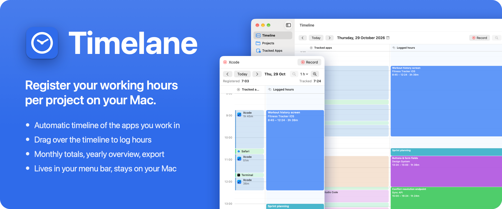

<p align="center"></p>

# Timelane

A native macOS app (SwiftUI) for developers to register working hours per project. It records which of your chosen apps are in the foreground and shows them on a day timeline, where you drag to assign time to projects. Everything is stored locally in SQLite.

## Features

- **Day timeline** with two lanes, "Tracked apps" (recorded automatically) and "Logged hours" (registered by you), each with a sticky header and separated by a divider. Drag over either lane to select a period, or click an app session to assign the whole session. Entries can be edited, moved and resized; right-click an entry for Edit or Delete. ⌘Z / ⇧⌘Z undo and redo changes to logged hours (create, edit, move, resize, delete), in the main window (also Edit ▸ Undo / Redo) and the menu bar panel. Zoom from the hour overview down to 10-minute detail (pinch or zoom controls); hover cards show details. The automatic entry of a linked app grows live, in step with its app session. At midnight the timeline moves on to the new day by itself (unless you are looking at another day or have the entry form open; then Today becomes available).
- **Record / Stop timer** (Cmd-R in the main window, also in the menu bar panel): Record starts one shared timer that survives closing the window and relaunching the app; Stop opens the new-entry form with the period rounded to whole minutes. A recording past midnight is cut at the end of its start day. A red block in "Logged hours" shows the running recording.
- **Projects** with a colour, an optional custom ID (your own free-text reference such as a customer or order code, unique per project, shown as a small badge next to the name everywhere and searchable in the entry form), monthly totals and month navigation (Cmd-Left / Cmd-Right, Cmd-T for the current month).
- **Month export**: *Export…* (⇧⌘E) on the Projects screen writes all hours of the shown month to a JSON or Excel (.xlsx) file; you choose the format and the location. Projects with a custom ID include it (`customId` / `projectCustomId` in JSON, an ID column in Excel).
- **Overview** (Cmd-4): a GitHub-style heatmap of the hours you registered per day in a calendar year (brighter square = more hours; hover for a card with the date and hours per project, click to open that day on the Timeline), with year navigation (Cmd-Left / Cmd-Right, Cmd-T), a project filter, statistic tiles (total, active days, average, busiest day), a stacked hours-per-month chart and a per-project breakdown.
- **Tracked apps**: only the apps you add are recorded. Tracking pauses on idle (after 5 minutes without input), sleep and screen lock. Optionally link an app to a project in the Project column: while you use it, a time entry for that project appears after 1 minute and grows every 5 seconds in "Logged hours" (small gaps of up to 1 minute merge into one entry, in step with the merged app block, and the entry keeps growing right away when you return to the app; also when Timelane is restarted in between or the visits were shorter than a minute; changing the link only affects new hours, idle time at the end of a run is removed, you can edit or delete it like any other entry and it is never overwritten afterwards).
- **Welcome tour**: a short, skippable carousel on first launch explains tracked apps, the two lanes and how to register hours. Reopen it any time via Help ▸ Welcome to Timelane.
- **Menu bar panel** with live tracking status (red dot while recording, grey "not tracking" icon for apps not on the list, grey pause icon when paused), the same timeline and a popup form to register time without opening the main window. The menu bar icon gets a small red dot while a recording runs. Tracking and the menu bar item keep running when the window is closed.
- **Local storage** in a SQLite database.

Keyboard: Cmd-1/2/3/4 switch between Timeline, Projects, Tracked Apps and Overview; in the project list of the entry form, Up/Down move the highlight and Enter chooses (or creates) the project.

## Requirements

- macOS 26.0 or later (the project's deployment target)
- Xcode 27.1 (used to develop it), Swift 6
- The app runs in the App Sandbox and needs no special permissions.

## Platforms

Timelane runs on macOS 26 and on iPhone/iPad (iOS 26). It is one multiplatform target that shares the database, sync and layout code.

The **iOS app** has no app tracking and no menu bar. It has four tabs:

- **Timeline**: one day with the *Logged hours* lane. Tap an empty spot to add an entry (a 30-minute slot, or the zoom step when zoomed in), touch and hold and drag to select a period, tap an entry to edit or delete it, pinch to zoom, swipe sideways (or use ‹ ›, the calendar and Today) to change day. Record / Stop sits in the navigation bar (the timer is local to the device and not synced).
- **Overview**: the yearly heatmap and statistics; tapping a day opens it on the Timeline.
- **Projects**: monthly totals per project, add / edit / archive / delete (swipe a row), and export of the month (Excel or JSON) to Files via the system file exporter.
- **Settings**: iCloud (sync and backup), the welcome tour and About.

Entries are moved or resized on iOS through the edit form (dragging them on the timeline is Mac-only for now). The first launch shows a shorter welcome tour without the tracking and menu bar pages. CI builds the iOS app for the Simulator on every pull request.

## Getting started

```sh
git clone https://github.com/NickKoepr/Timelane.git
cd Timelane
open Timelane.xcodeproj
```

Swift Package Manager resolves [GRDB](https://github.com/groue/GRDB.swift) (7.x) automatically. Select the `Timelane` scheme and run (bundle ID `nl.nickkoepr.timelane`). From the command line:

```sh
xcodebuild -project Timelane.xcodeproj -scheme Timelane -destination 'platform=macOS' -derivedDataPath build/DerivedData build
xcodebuild -project Timelane.xcodeproj -scheme Timelane -destination 'platform=macOS' -derivedDataPath build/DerivedData test
```

You will need to select your own development team under Signing & Capabilities.

## Architecture

Strict MVVM with one-directional dependencies:

- **Models**: plain value types (`Project`, `TimeEntry`, `AppSession`, `TrackedApp`).
- **Repositories**: protocols with GRDB implementations (`Repositories/GRDB`); they throw, view models catch.
- **ViewModels**: `@Observable @MainActor` classes with injected dependencies; no GRDB and no SwiftUI view types.
- **Views**: SwiftUI only, talking to view models. Each view has a `#Preview` using `AppEnvironment.preview()`.
- **Composition root**: `AppEnvironment` wires the database, repositories and tracker.
- **Tracking**: `AppActivityTracker` consumes an event stream (foreground app changes, idle, sleep, lock, heartbeat) and writes app sessions.
- **Database**: GRDB `DatabaseQueue` with migrations in `Migrations.swift`. Never edit an existing migration; add a new one.
- **Layout logic**: pure, unit-tested geometry and merging code in `Features/Timeline/Layout`.

## Project structure

```
Timelane/
  App/                  App entry point, AppDelegate, AppEnvironment (composition root)
  Models/               Value types: Project, TimeEntry, AppSession, TrackedApp
  Database/             AppDatabase (live/in-memory), Migrations.swift, Records/ (GRDB conformances)
  Repositories/         Repository protocols; GRDB/ holds the implementations
  Services/             Day totals, overlap resolving, running apps, app icons
    Activity/           Pure yearly statistics: day bucketing, heatmap layout, levels, statistics
    Backup/             iCloud backup (part of the iCloud switch): CloudBackupService, CloudKit store, parts, schedules, safety and ownership rules
    Sync/               Opt-in iCloud sync of projects and entries: SyncService, CloudKit engine, pure merge/conflict rules, fakes for tests
    Tracking/           AppActivityTracker, AutoTimeLogger (linked app → growing entry), idle detection, system event observer, heartbeat
  Utilities/            DateRange, calendar helpers, duration formatting, colours
  Features/
    Root/               RootView and sidebar navigation
    Timeline/           Day timeline and time entry form
      Layout/           Pure geometry, zoom, drag and hover-card placement logic
      ViewModels/       TimelineViewModel, TimeEntryFormViewModel, ProjectSearch, ...
      Views/            Lanes, blocks, hover cards, form sheet
    Projects/           ViewModels/ and Views/ for projects and monthly totals
    Overview/           Yearly heatmap, statistics and charts
    TrackedApps/        ViewModels/ and Views/ for the tracked-apps list
    Settings/           Settings window (Timelane ▸ Settings…, ⌘,): the iCloud setting (sync and backup)
  MenuBar/              Menu bar panel: view model, content, form popup
  Debug/Screenshots/    DEBUG-only screenshot mode for the App Store images (sample data, self-capture)
  Assets.xcassets/      Accent colour and AppIcon
TimelaneTests/          Swift Testing unit tests
Tools/                  generate-app-icon.swift (app icon, menu bar icon, clock mark), make-app-store-screenshots.sh + compose-app-store-screenshots.swift, generate-readme-header.swift
docs/                   Images used by this README
website/                Static product website (GitHub Pages)
```

## Data & privacy

The database is a single SQLite file inside the app's sandbox container:

`~/Library/Containers/nl.nickkoepr.timelane/Data/Library/Application Support/Timelane/db.sqlite`

It stores projects, your time entries (start, end, optional title and note), the list of tracked apps, and app sessions: app name, bundle identifier, start and end. No window titles, keystrokes or screenshots are recorded. Nothing leaves your machine unless you turn on iCloud (see below); then your data goes only to your own private iCloud. Exported files are written only where you choose in the save panel.

## iCloud (sync and backup)

Optional and off by default: one switch, *iCloud Sync & Backup*, in *Timelane ▸ Settings…* (⌘,) on the Mac and *Settings ▸ iCloud* on iPhone and iPad. It keeps **projects and logged hours** (time entries) the same on all your devices, and keeps a backup of them you can go back to. Everything goes only to your *private* CloudKit database (`iCloud.nl.nickkoepr.timelane`); nothing is shared with anyone.

### Sync

Changes usually arrive within seconds: besides iCloud's push notifications (best effort), the app checks for changes right away when it comes on screen and then every 30 s while the app is on screen (every 60 s while only the Mac menu bar panel is open; nothing is checked while neither is visible). *Sync Now* always asks iCloud and updates *Last synced*.

- **What syncs:** projects (name, colour, archived, customer id) and time entries (times, title, note, project).
- **What does not:** app sessions (the tracked-apps lane), the list of tracked apps and the Record timer stay on each device (app activity is backed up from the Mac, see below).
- **Turning it on:** if iCloud already holds Timelane data you are always asked: *Replace iCloud data with this Mac*, or *Replace this Mac's data with iCloud* (local projects and entries are replaced; app sessions and tracked apps stay). If iCloud has no synced data but does have a backup with data, you can restore that backup (it becomes the iCloud data) or use this device's data. Otherwise this device's data is simply uploaded.
- **Replacing iCloud data** from one device replaces the projects and hours on every other device too (there is one iCloud dataset); they show a notice. If the iCloud data is removed instead (iCloud settings), the other devices turn iCloud off and keep their data.
- **Turning it off** stops syncing and backups and keeps the data on this device and in iCloud. Signing out of iCloud or switching Apple ID turns it off with a message; data is never moved between accounts silently.
- **Conflicts:** the most recent change wins. For a time entry, the times, the title/note and the project are resolved separately, so a rename on one Mac and a move on another both survive. If a project is deleted on one Mac and edited on another, the delete wins; if an entry was added to a deleted project, the project comes back. Projects with the same name created on two Macs are merged; if two projects get the same customer id, the older edit keeps it and you see a notice. Entries never overlap: after a sync overlaps are resolved the same way as when you edit (newest action wins).
- **Requirements:** iCloud signed in, the iCloud (CloudKit) and Push Notifications capabilities on the App ID, and the same or a newer Timelane on every device (one that is too old shows "Update Timelane on this device to keep syncing"). CI builds strip the entitlements (`CODE_SIGN_ENTITLEMENTS=`).

### Backup

There is **one shared backup** in iCloud, in two parts (CloudKit records of type `DatabaseBackup`, each one SQLite file plus device name, app version, schema version and counts):

- **Projects and hours** (`projectsAndHours`): written by any device, automatically after changes (at most every 15 minutes) and only once that device is *caught up* with sync: it finished a sync pass since launch, sent all its changes, and sync is not paused or failing. So a device that was closed for a week never uploads old data before it fetched. The only thing a backup can miss is a change another device was sending at that very moment. An automatic backup never replaces a backup that holds data with an empty database (e.g. after a reinstall).
- **App activity** (`appActivity`, Mac only): app sessions and the tracked apps list (with their project links), backed up once an hour. An iPhone never touches it. When the activity backup in iCloud was made by another Mac (a new Mac, or a second one), that activity is first added to this Mac and then the backup is replaced, so nothing is lost; with two Macs both end up with each other's activity. Settings show one backup: the split is technical.
- **Back Up Now** syncs first and then backs up both parts.
- **Restore Backup…** replaces the projects and logged hours **on all devices** with the backup (the iCloud data is replaced and the other devices follow). On a Mac it also adds the app sessions and tracked apps from the backup that this Mac is missing (nothing is removed). A copy of the whole database is kept as `db-before-restore.sqlite` next to `db.sqlite`. If the app quits or goes offline halfway, the iCloud part finishes on the next sync.
- **Older versions** had a separate backup switch and one whole-database record (`latest`). It stays readable as a restore source until it is no longer needed: it is removed once an app activity backup exists, or right away when it holds no app activity. A device that had only the old backup switch on (sync off) shows a one-time notice that backups now need iCloud on.

## Website

The product website lives in `website/` (static HTML + CSS, no build step) and is deployed to GitHub Pages by `.github/workflows/pages.yml` on pushes to `main` that touch it. See `website/README.md`.

## Development

- [`AGENTS.md`](AGENTS.md) explains the architecture, conventions, workflow and known pitfalls for anyone (or any AI agent) continuing work on the project; `CLAUDE.md` points to it.

- Tests use Swift Testing (140+ tests) and run with the `xcodebuild ... test` command above. Repository and view model tests use an in-memory database.
- In DEBUG builds the launch argument `-resetDatabase YES` deletes the database at startup. Use it with care: it wipes your data.
- Conventions (see [`AGENTS.md`](AGENTS.md)): one type per file, small files, views never call repositories directly, pure logic in unit-tested structs, no dependencies besides GRDB.
- The app icon, the matching menu bar icon and the clock mark used in the welcome tour (same clock, as template images) (plus the iOS icon in light, dark and tinted variants, and the icon set's `Contents.json`) are generated by `swift Tools/generate-app-icon.swift Timelane/Assets.xcassets/AppIcon.appiconset Timelane/Assets.xcassets/MenuBarIcon.imageset Timelane/Assets.xcassets/ClockMark.imageset` and committed in the asset catalog.
- App Store screenshots: `Tools/make-app-store-screenshots.sh` builds an unsandboxed DEBUG copy (bundle id `nl.nickkoepr.timelane.screenshots`), lets it show sample data on every screen and capture its own windows, then composes 2880 × 1800 images in the icon's blue with a short title into `build/AppStoreScreenshots/`. The app comes to the front for a few seconds per scene; your own app and data are not touched. Pass scene names (`timeline entryForm menuBar projects overview trackedApps settings`) to redo only some.
- README header: after the screenshot captures, `swift Tools/generate-readme-header.swift build/AppStoreScreenshots/raw Timelane/Assets.xcassets/AppIcon.appiconset/icon_1024.png docs/header.png` redraws `docs/header.png` (icon, name, key features, Timeline window and menu bar panel).

## Continuous integration


Every pull request to `main` runs the unit tests on GitHub Actions (`.github/workflows/tests.yml`, macOS runner with Xcode 27, ad-hoc code signing); new commits on the PR re-run them and cancel the outdated run. Docs-only changes (`*.md`, `docs/`, `website/`) are skipped, so a required status check would stay pending on such PRs (no branch protection is configured). To run it manually: Actions tab, Tests, Run workflow.
